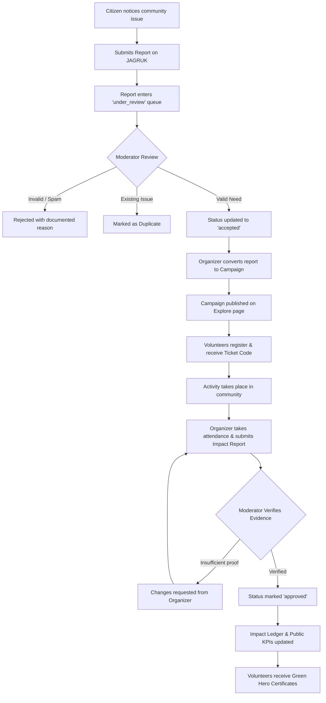
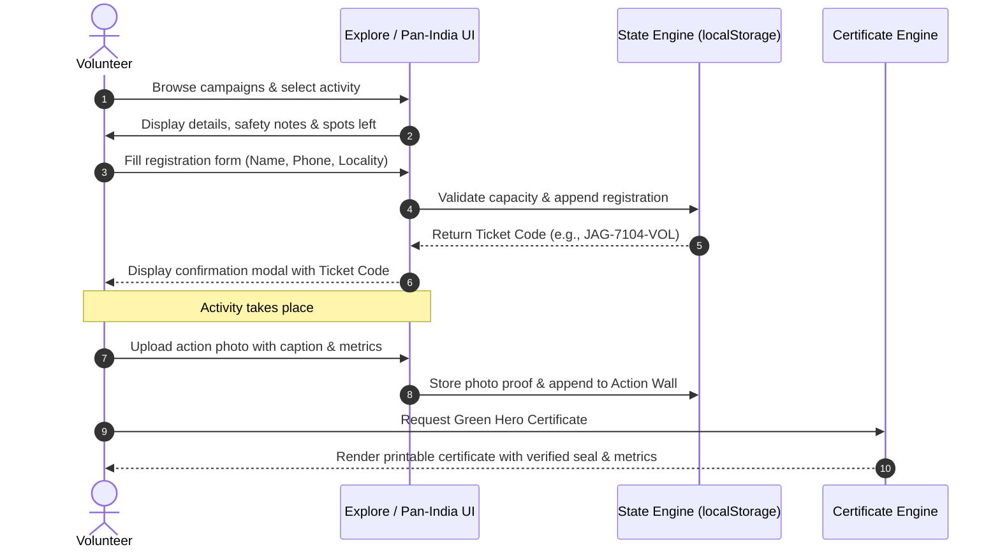
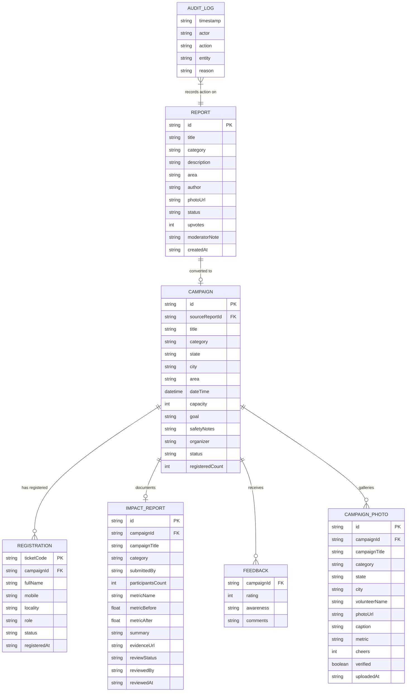
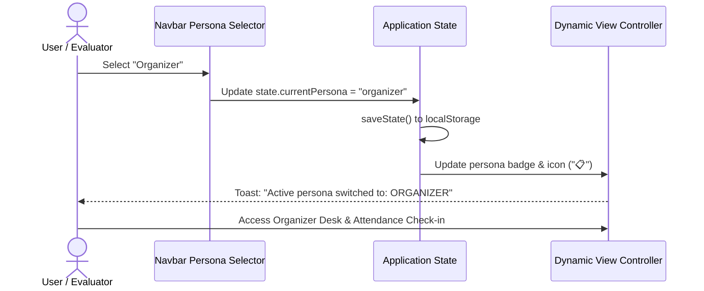

# JAGRUK — Community Awareness & Action Network

> **"Don't Just Spread Awareness. Create Action."**

[](https://github.com/pavanidhole21-droid/Organize_awareness_programmes)
[-0d9488?style=for-the-badge)](https://github.com/pavanidhole21-droid/Organize_awareness_programmes)
[](https://github.com/pavanidhole21-droid/Organize_awareness_programmes)
[](https://nodejs.org)
[](https://vercel.com)
[](package.json)

**JAGRUK** is an all-in-one community engagement platform designed to transform passive civic awareness into coordinated, accountable, and measurable local action. Built as a flagship Community Engagement Project (CEP) for colleges, NGOs, and civic action groups, JAGRUK bridges the gap between identifying civic issues (such as illegal waste dumping, dark-spot hazards, and public park neglect) and executing hands-on volunteer drives with verified evidence and transparent outcome tracking.

---

## 📚 Table of Contents

- [Overview](#-overview)
- [Problem Statement](#-problem-statement)
- [Solution](#-solution)
- [Core Features](#-core-features)
- [User Roles & Capabilities](#-user-roles--capabilities)
- [Complete Application Flow](#-complete-application-flow)
- [System Architecture](#️-system-architecture)
- [Technology Stack](#️-technology-stack)
- [Project Structure](#-project-structure)
- [Frontend Architecture](#-frontend-architecture)
- [Backend Architecture](#-backend-architecture)
- [Database & State Architecture](#️-database--state-architecture)
- [API & Server Documentation](#-api--server-documentation)
- [Authentication & Access Control](#-authentication--access-control)
- [Important Technical Workflows](#-important-technical-workflows)
- [Environment Variables](#-environment-variables)
- [Installation & Setup](#-installation--setup)
- [Running the Application](#-running-the-application)
- [Screenshots & Demo](#-screenshots--demo)
- [Testing](#-testing)
- [Security, Safety & Privacy](#-security-safety--privacy)
- [Deployment](#-deployment)
- [Known Limitations](#️-known-limitations)
- [Future Scope](#-future-scope)
- [Technical Decisions](#-technical-decisions)
- [Contributing](#-contributing)
- [Contributors](#-contributors)
- [License](#-license)

---

## 📌 Overview

Traditional civic initiatives often suffer from **"awareness fatigue"**: residents acknowledge local problems, flyers are distributed, and WhatsApp notices circulate, yet actual remediation rarely happens because there is no structured pipeline connecting civic reports to organized volunteer labor.

**JAGRUK** provides that structured pipeline. It is a lightweight, responsive web application that enables:
1. **Citizens** to report non-emergency neighborhood problems with approximate geolocation and photos.
2. **Moderators** to review incoming reports, filter duplicates, sanitize private information, and ensure safety.
3. **Organizers** (student leads, faculty mentors, and NGOs) to convert verified reports directly into scheduled volunteer campaigns with strict capacity limits and safety guidelines.
4. **Volunteers** to discover initiatives across local wards and nationwide regions (e.g., tea plantation revivals in Assam/Darjeeling, afforestation drives in Nagpur, and wetland cleanups in Bengaluru), claim digital passes, attend drives, and upload verifiable photo proof.
5. **Communities** to inspect an immutable **Impact Ledger** that tracks verifiable before-and-after metrics, volunteer turnout, and resident feedback.

---

## 🎯 Problem Statement

```
Existing Problem
  ├── Civic awareness campaigns remain fragmented across WhatsApp, social media, and paper notices.
  └── Residents notice neighborhood issues but lack a direct mechanism to organize or participate in solutions.
       ↓
Challenges
  ├── Organizers struggle to recruit, register, and track volunteers with safety compliance.
  ├── Submitted complaints often duplicate municipal efforts or lack verification.
  └── Most community drives never document verifiable before-and-after outcomes.
       ↓
Impact
  ├── Community skepticism grows over whether awareness events make any real difference.
  └── Student community engagement projects (CEP) fail to produce tangible, auditable results.
       ↓
Need for a Better Solution
  └── A single, accessible, trilingual web platform that converts civic reports into structured, 
      moderated volunteer campaigns and verifies outcomes in a public impact ledger.
```

---

## 💡 Solution

JAGRUK solves this through an end-to-end **Awareness-to-Action Pipeline**:

1. **Structured Civic Intake**: Citizens report non-emergency problems in 4 categories (*Cleanliness, Safety, Health, Environment*).
2. **Moderation & Duplicate Screening**: Human moderators review reports before publication, preventing spam, privacy violations, or municipal ticket duplication.
3. **One-Click Campaign Conversion**: Organizers transform accepted issues into actionable drives with clear goals, capacity caps, safety requirements, and equipment provision.
4. **Frictionless Volunteer Onboarding**: Volunteers register in seconds, generating unique digital attendance ticket codes (e.g., `JAG-7104-VOL`).
5. **Verified Evidence Ledger**: Post-event outcomes require physical metric records (e.g., kg waste removed, saplings planted), photographic evidence, and moderator verification before appearing on the public impact dashboard.
6. **Pan-India Green Action Wall**: Expands localized college drives to nationwide environmental action, enabling volunteers across Indian states to publish geotagged action photos and receive official **Citizen Green Action Certificates**.

---

## ✨ Core Features

### 👤 Citizen & Resident Features
- **Report a Need**: Submit neighborhood civic problems with title, category, description, approximate location, and optional photo.
- **Privacy & Safety Safeguards**: Integrated non-emergency banner prominently displaying official helplines (Police: `100`, Ambulance: `108`, National Emergency: `112`), with explicit consent confirmation checkboxes.
- **Interactive Need Board**: Filter reported problems by category (*Cleanliness, Safety, Health, Environment*) and status (*Under Review, Accepted, Converted to Campaign, Resolved, Duplicate*).
- **Civic Upvoting**: Upvote reported needs to signal neighborhood urgency to organizers.

### 🤝 Volunteer Features
- **Explore Campaigns**: Browse active community initiatives filtered by category, state, city, and status.
- **Real-Time Capacity Tracker**: Visual progress bar indicating registered volunteers vs. campaign maximum capacity.
- **One-Click Registration**: Instant volunteer sign-up generating a unique verified ticket code.
- **Citizen Action Photo Wall**: Browse crowd-sourced community action photos and applaud fellow volunteers with real-time "Cheers".
- **Printable Green Hero Certificate**: Dynamic certificate generation with official verification seals, personalized recipient names, campaign metrics, and print/PDF export.

### 📋 Organizer Features
- **Direct Campaign Publishing**: Create volunteer campaigns complete with goals, schedule, safety protocols, location, and capacity.
- **Awareness-to-Action Conversion**: Seamlessly convert accepted reports from the Need Board into live campaigns with linked lineage.
- **Attendee Roster Management**: Real-time roster of registered volunteers with check-in toggle (*Registered / Attended / No-Show*).
- **Impact Report Submission**: File structured post-activity records with baseline (`before`) and post-cleanup (`after`) numerical metrics, evidence images, and executive summaries.

### 🛡️ Moderator & Admin Features
- **Review Queue**: Evaluate pending community submissions with one-click Accept, Reject, or Merge Duplicate controls.
- **Mandatory Moderation Audit**: System enforces audit logging for all moderation decisions, recording actor, action, timestamp, and justification.
- **Impact Report Verification**: Review organizer-submitted impact evidence before results reflect on public KPI counters.
- **Immutable Audit Trail**: Transparent table of all platform governance actions.

### 🌐 System & Accessibility Features
- **Trilingual Localization (i18n)**: Instant switching between **English**, **मराठी (Marathi)**, and **हिंदी (Hindi)**.
- **Persona Simulator**: Switch active roles (*Resident, Volunteer, Organizer, Moderator*) from the navbar to test role-specific workflows.
- **Dark / Light Theme**: Full CSS-tokenized dark and light themes with smooth transitions.
- **Interactive 60-Second Demo Tour**: Built-in 7-step guided walkthrough stepping through the complete PRD lifecycle.
- **Client-Side State Engine & Persistence**: Instant local persistence using `localStorage` with seed recovery and state migration.
- **Demo State Reset**: Single-click button to reset all demo campaigns, reports, and logs to baseline seed data.

---

## 👥 User Roles & Capabilities

| Role | Interface | Key Capabilities |
| :--- | :--- | :--- |
| **Resident / Citizen** | Public Portal | Browse campaigns, submit civic reports, upvote community needs, rate completed activities. |
| **Volunteer** | Public Portal | Register for campaigns, receive digital ticket codes, attend drives, upload action photos, print Green Action Certificates. |
| **Organizer** | Organizer Desk | Create campaigns, convert accepted reports into drives, manage attendee check-ins, submit impact metrics. |
| **Moderator / Admin** | Moderator Console | Review incoming reports, reject invalid submissions, flag duplicates, verify impact evidence, inspect audit logs. |

---

## 🔄 Complete Application Flow

### 1. Awareness-to-Action Lifecycle


### 2. Volunteer Participation Flow


---

## 🏗️ System Architecture

```mermaid
flowchart TB
    subgraph ClientBrowser [Client Browser Environment]
        subgraph PresentationLayer [Presentation Layer]
            HTML[index.html Semantic DOM]
            CSS[style.css Design Tokens & Dark/Light Themes]
            UIViews[View Switcher: Home, Pan-India, Explore, Needs, Organizer, Moderator, Impact]
            Modals[Modals: Register, Detail, Convert, Impact, Photo Upload, Certificate]
        end

        subgraph ApplicationLayer [Application State & Logic (app.js)]
            I18N[i18n Translation Engine (EN, MR, HI)]
            PersonaManager[Persona Switcher & Role Simulator]
            StateEngine[loadState / saveState / Migration Engine]
            ActionHandlers[Event Handlers & Form Validators]
            CertEngine[Certificate Generator & Print Formatter]
            TourEngine[Guided 60s Demo Controller]
        end

        subgraph StorageLayer [Local Persistence]
            LocalStorage[(Browser LocalStorage: 'JAGRUK_STATE_V1')]
        end
    end

    subgraph ServerLayer [Server / Hosting Layer]
        NodeServer[Node.js Static File Server (server.js)]
        VercelEdge[Vercel Edge CDN / Hosting]
    end

    HTML <--> UIViews
    UIViews <--> ActionHandlers
    ActionHandlers <--> StateEngine
    StateEngine <--> LocalStorage
    I18N <--> UIViews
    PersonaManager <--> UIViews
    CertEngine <--> Modals

    ClientBrowser <== HTTP GET (Static Assets) ==> NodeServer
    ClientBrowser <== HTTP GET (Static Assets) ==> VercelEdge
```

---

## 🛠️ Technology Stack

| Layer | Technology | Version | Purpose in Project |
| :--- | :--- | :--- | :--- |
| **Frontend UI** | HTML5 Semantic Elements | Latest standard | Accessible layout, SEO meta tags, modal overlays, emergency alert banners. |
| **Styling** | Vanilla CSS3 | Custom System | CSS Custom Properties (tokens), glassmorphism, responsive grid, light/dark modes. |
| **Typography** | Google Fonts | Web Font API | `Outfit` (display headings), `Inter` (body copy), `Noto Sans Devanagari` (Marathi/Hindi). |
| **Client Logic** | Vanilla JavaScript | ECMAScript 2022+ | Reactive view switching, DOM rendering, form validation, ticket/certificate generation. |
| **Internationalization** | In-Memory i18n Dictionaries | Custom ES6 Object | Trilingual interface strings for English, Marathi (`mr`), and Hindi (`hi`). |
| **Client Storage** | HTML5 Web Storage API | `localStorage` | Complete client-side database engine under key `JAGRUK_STATE_V1`. |
| **Local Web Server** | Node.js Built-in Modules | v18.0.0+ | Zero-dependency HTTP static server (`http`, `fs`, `path`) in `server.js`. |
| **Deployment Platform** | Vercel | v2 API | Global CDN edge deployment configured via `vercel.json`. |
| **Automation Scripts** | Windows Batch Scripts | `.bat` | One-click launch (`run.bat`) and CLI deployment (`deploy-vercel.bat`). |

---

## 📁 Project Structure

```
c:\Users\PAVANI\OneDrive\Pictures\Desktop\CEP\
├── .gitignore             # Excludes node_modules, logs, and OS cache files
├── README.md              # Official technical documentation & architecture guide
├── app.js                 # Core client application logic, state engine & event handlers (82 KB)
├── deploy-vercel.bat      # Windows batch automation to trigger interactive Vercel CLI deploy
├── index.html             # Main single-page application structure & semantic views (58 KB)
├── package.json           # Project manifest, npm metadata, scripts & MIT license configuration
├── prd.md                 # Original College CEP Product Requirements Document (PRD v1.0)
├── run.bat                # One-click Windows runner: opens browser to http://localhost:3000 & boots server
├── server.js              # Native Node.js static file HTTP server with MIME type resolver
├── style.css              # Complete design system, color variables, components & responsive rules (41 KB)
└── vercel.json            # Vercel deployment configuration with cleanUrls enabled
```

### Purpose of Key Files
- [`index.html`](file:///c:/Users/PAVANI/OneDrive/Pictures/Desktop/CEP/index.html): Defines all 7 view sections (`view-home`, `view-panindia`, `view-explore`, `view-needs`, `view-report`, `view-organizer`, `view-moderator`, `view-impact`) and 8 modal dialogs inside an accessible single-page layout.
- [`app.js`](file:///c:/Users/PAVANI/OneDrive/Pictures/Desktop/CEP/app.js): Acts as the full-stack brain of the prototype. Contains seed records, state persistence functions (`loadState`, `saveState`), view renderers, form handlers, ticket generators, and photo upload decoders.
- [`style.css`](file:///c:/Users/PAVANI/OneDrive/Pictures/Desktop/CEP/style.css): Custom CSS design system with curated HSL and hex tokens (`--primary-*`, `--accent-*`), fluid typography, accessible contrast, and mobile-first media queries.
- [`server.js`](file:///c:/Users/PAVANI/OneDrive/Pictures/Desktop/CEP/server.js): Zero-dependency Node.js HTTP server mapping requests to filesystem assets, serving correct MIME types, and handling port fallback.
- [`vercel.json`](file:///c:/Users/PAVANI/OneDrive/Pictures/Desktop/CEP/vercel.json): Instructs Vercel's edge network to host the project with clean URLs.

---

## 🎨 Frontend Architecture

The frontend follows a **Modular Single-Page Application (SPA)** architecture using native browser primitives without external heavy framework dependencies.

### 1. View Routing & Switching
View switching is managed by `switchView(viewName)`:
- Hides all `.view-section` containers and activates the target section by adding `.active`.
- Smoothly scrolls to the top of the viewport.
- Triggers view-specific data rendering routines (`renderHome()`, `renderExplore()`, `renderNeedsBoard()`, `renderOrganizer()`, `renderModerator()`, `renderImpact()`, `renderPanIndia()`).

### 2. UI Component Architecture
- **KPI Dashboards**: Dynamically computed metric cards reflecting live counts from the state array.
- **Capacity Meter**: Real-time percentage bars (`width: (registeredCount / capacity) * 100%`) showing spot availability with automatic "FULL" badges.
- **Card Grids**: Responsive CSS Grid layouts with CSS hover micro-interactions, category color tags, and date formatters.
- **Modal Dialog System**: Centralized modal management with backdrop click dismissal (`closeModalOnOutsideClick`), escape key support, and focus management.
- **Live Image Dropper**: Supports reading local device image files into memory via HTML5 `FileReader` (`readAsDataURL`) for instant thumbnail preview before publishing.

---

## ⚙️ Backend Architecture

The local backend is implemented as a lightweight, secure Node.js HTTP file server in [`server.js`](file:///c:/Users/PAVANI/OneDrive/Pictures/Desktop/CEP/server.js).

### Request-Response Lifecycle

```
Client Browser
      │
      │ HTTP GET /index.html (or /style.css, /app.js)
      ▼
Node.js http.createServer
      │
      ├── 1. Parse URL & resolve query parameters: req.url.split('?')[0]
      ├── 2. Map root '/' to '/index.html'
      ├── 3. Resolve absolute path: path.join(__dirname, reqUrl)
      ├── 4. Inspect file extension & lookup MIME_TYPES:
      │      - .html → text/html
      │      - .css  → text/css
      │      - .js   → text/javascript
      │      - .json → application/json
      │      - .png/.jpg/.svg → image/*
      ▼
fs.readFile(filePath)
      ├── [File Exists] ──► 200 OK, 'Content-Type': contentType, 'Cache-Control': 'no-cache'
      ├── [ENOENT]      ──► 404 Not Found ('Content-Type': 'text/plain')
      └── [Error]       ──► 500 Server Error ('Content-Type': 'text/plain')
```

---

## 🗄️ Database & State Architecture

In the current prototype, data persistence is powered by a structured client-side state engine backed by browser `localStorage` under the key `JAGRUK_STATE_V1`.

### Data Entity Relationship Diagram



### Entity Schemas

#### 1. `Report`
- `id` (String): Unique identifier (e.g., `rep-1`).
- `title` (String): Concise headline of the civic issue.
- `category` (String): Categorization (*Cleanliness, Safety, Health, Environment*).
- `description` (String): Full issue description.
- `area` (String): Approximate locality or landmark (not private address).
- `author` (String): Name or initial of the submitting resident.
- `photoUrl` (String): Optional URL or base64 image string.
- `status` (String): Current state (`under_review`, `accepted`, `converted_to_campaign`, `resolved`, `duplicate`, `rejected`).
- `upvotes` (Integer): Count of community support votes.
- `moderatorNote` (String | null): Notes entered during moderation review.
- `createdAt` (String): Submission timestamp.

#### 2. `Campaign`
- `id` (String): Unique campaign identifier (e.g., `camp-1`).
- `sourceReportId` (String | null): Foreign key linking back to the triggering `Report.id`.
- `title` (String): Public title of the volunteer drive.
- `category` (String): Activity domain.
- `state` (String): Indian State (e.g., *Maharashtra, Assam, Kerala, West Bengal, Karnataka*).
- `city` (String): City/Town name (e.g., *Nagpur, Jorhat, Munnar, Darjeeling, Bengaluru*).
- `area` (String): Specific landmark or venue.
- `dateTime` (ISO-8601 String): Scheduled date and time.
- `capacity` (Integer): Maximum permitted volunteers (enforces safety & supervision).
- `goal` (String): Measurable objective of the activity.
- `safetyNotes` (String): Required protective gear, precautions, and equipment provided.
- `organizer` (String): Name and affiliation of the event coordinator.
- `status` (String): Life cycle stage (`published`, `full`, `in_progress`, `completed`, `cancelled`).
- `registeredCount` (Integer): Current tally of enrolled volunteers.

#### 3. `Registration`
- `ticketCode` (String): Cryptographic/random pass code (e.g., `JAG-7104-VOL`).
- `campaignId` (String): Foreign key linking to `Campaign.id`.
- `fullName` (String): Volunteer name.
- `mobile` (String): Contact number (kept private from public views).
- `locality` (String): Volunteer's home area or college department.
- `role` (String): Role designation (`volunteer`).
- `status` (String): Attendance state (`registered`, `attended`, `no_show`).
- `registeredAt` (String): Timestamp of registration.

#### 4. `ImpactReport`
- `id` (String): Unique impact record identifier (e.g., `imp-1`).
- `campaignId` (String): Foreign key to completed `Campaign.id`.
- `campaignTitle` (String): Denormalized campaign title for ledger display.
- `category` (String): Initiative category.
- `submittedBy` (String): Organizer name.
- `participantsCount` (Integer): Verified count of attendees.
- `metricName` (String): Observable unit of work (e.g., *Kg Plastic Waste Removed, Trees Planted*).
- `metricBefore` (Float): Measured baseline before the drive.
- `metricAfter` (Float): Measured post-activity result.
- `summary` (String): Narrative report of outcomes and community reaction.
- `evidenceUrl` (String): Photo proof URL.
- `reviewStatus` (String): Verification state (`pending`, `approved`, `rejected`).
- `reviewedBy` (String): Faculty or moderator verifying the outcome.
- `reviewedAt` (String): Approval timestamp.

---

## 🔌 API & Server Documentation

### 1. HTTP Static File Server (`server.js`)

| Method | Endpoint | Description | Content-Type | Auth Required |
| :--- | :--- | :--- | :--- | :--- |
| `GET` | `/` | Serves main single page application | `text/html` | No |
| `GET` | `/index.html` | Serves entry HTML file | `text/html` | No |
| `GET` | `/style.css` | Serves global design system styles | `text/css` | No |
| `GET` | `/app.js` | Serves client application logic and state engine | `text/javascript` | No |
| `GET` | `/package.json` | Serves project metadata | `application/json` | No |
| `GET` | `/*.(png\|jpg\|svg\|ico)` | Serves visual assets | `image/*` | No |

### 2. Client-Side State Operations API (`app.js`)

While HTTP routes handle static delivery, core data mutation occurs through state engine controller methods:

#### `handleReportSubmit(event)`
- **Trigger**: Submission of `#reportForm` in `view-report`.
- **Input**: Form fields (`title`, `category`, `description`, `area`, `author`, `photoUrl`).
- **Validation**: Requires non-empty title/description, category selection, and explicit DPDP consent checkbox.
- **State Mutation**: Prepends new object to `state.reports` with status `under_review`, records audit log, triggers toast notification, switches view to `needs`.

#### `handleRegisterSubmit(event)`
- **Trigger**: Submission of `#registerForm` in `registerModal`.
- **Input**: `campaignId`, `fullName`, `mobile`, `locality`.
- **Validation**: Verifies `campaign.registeredCount < campaign.capacity`.
- **Output**: Generates pass `JAG-XXXX-VOL`, increments `registeredCount`, marks `full` if capacity reached, updates localStorage.

#### `handleImpactSubmit(event)`
- **Trigger**: Submission of `#impactReportForm` in `impactReportModal`.
- **Input**: `campaignId`, `participantsCount`, `metricName`, `metricBefore`, `metricAfter`, `summary`, `evidenceUrl`.
- **State Mutation**: Appends to `state.impactReports` with status `pending`, creates audit trail entry.

#### `handleModeratorAction(reportId, action, reason)`
- **Trigger**: Moderator console controls.
- **Actions**: `accept` (sets status to `accepted`), `reject` (records rejection note), `duplicate` (marks duplicate).
- **Audit**: Writes timestamp, actor name, action verb, and mandatory justification note to `state.auditLogs`.

---

## 🔐 Authentication & Access Control

### Prototype Persona Simulation
To facilitate academic review, live grading, and hackathon evaluation without requiring multiple email accounts, JAGRUK implements an **Active Persona Simulator**:

- **Resident**: Access to submission forms, need board upvoting, activity browsing, and post-activity feedback.
- **Volunteer**: Enrolls in campaigns, views attendance passes, submits action photos, and generates certificates.
- **Organizer**: Access to campaign creation forms, attendee rosters, and impact submission dialogs.
- **Moderator / Admin**: Exclusive access to the review queue, duplicate merging controls, audit logs, and impact verification.

### Role Switching Architecture


> [!NOTE]
> *Production Auth Roadmap*: For multi-tenant production deployment, the PRD outlines replacing the persona switcher with **Supabase Auth** or **OAuth 2.0 / JWT** with Postgres Row-Level Security (RLS). In the current prototype, role enforcement is simulated client-side.

---

## 🔄 Important Technical Workflows

### 1. Issue Reporting & Verification Workflow
1. Resident navigates to **Report a Need** (`#view-report`).
2. Reads the **Non-Emergency Alert** and confirms consent.
3. Fills in civic issue details (e.g., *Stagnant water near school*).
4. Submits form &rarr; Input validated &rarr; `rep-X` record pushed with status `under_review`.
5. Evaluator switches persona to **Moderator** &rarr; Navigates to **Moderator Console**.
6. Inspects the pending report, confirms non-emergency status, enters review note, and clicks **Accept**.
7. Audit entry generated: `[APPROVE_REPORT] Report #rep-X`.

### 2. Campaign Conversion & Registration Workflow
1. Organizer views accepted reports in the **Need Board** (`#view-needs`).
2. Clicks **Convert to Campaign** on an accepted report.
3. Modal auto-populates issue details; organizer defines schedule, capacity (e.g., `25`), and safety notes (e.g., *Gloves provided*).
4. Clicks **Publish Campaign** &rarr; Report status becomes `converted_to_campaign`; new `Campaign` record is created.
5. Evaluator switches to **Volunteer** &rarr; Opens **Explore Activities** &rarr; Clicks **Join Activity**.
6. Submits registration &rarr; Generates ticket code (e.g., `JAG-7104-VOL`) &rarr; Capacity bar increments to `1/25`.

### 3. Pan-India Photo Upload & Certificate Generation
1. Volunteer participates in a drive (or selects a demo drive from Assam, Munnar, Darjeeling, or Nagpur).
2. Opens **Pan-India Hub** &rarr; Clicks **Upload Action Photo**.
3. Selects campaign, enters participant name, attaches image proof (via file drag-and-drop or sample preset), inputs metrics (e.g., *50 Saplings Planted*), and confirms photo consent.
4. Action card instantly publishes to the **Citizen Action Wall** with cheer counter.
5. Clicks **Generate Certificate** &rarr; System creates a formatted, watermark-embossed **Certificate of Green Action** with official verification seal, ready for browser printing or PDF saving.

---

## 🔐 Environment Variables

The server operates with zero required configuration by default, but respects standard environment variables:

| Variable | Description | Default Value | Required |
| :--- | :--- | :--- | :--- |
| `PORT` | HTTP port on which `server.js` listens | `3000` | No |

To launch on a custom port in PowerShell:
```powershell
$env:PORT="8080"; node server.js
```

---

## 🚀 Installation & Setup

### Prerequisites
- **Node.js**: Version 18.0.0 or higher ([Download Node.js](https://nodejs.org))
- **Git**: Installed and configured on your system
- **Modern Web Browser**: Google Chrome, Mozilla Firefox, Microsoft Edge, or Safari

### Step-by-Step Installation

1. **Clone the Repository**
   ```bash
   git clone https://github.com/pavanidhole21-droid/Organize_awareness_programmes.git
   cd Organize_awareness_programmes
   ```

2. **Verify Project Files**
   Ensure all core files are present:
   ```bash
   # On Windows PowerShell:
   Get-ChildItem
   ```

3. **Install Dependencies**
   The core platform uses native Web APIs and built-in Node.js modules, requiring **zero external npm packages**:
   ```bash
   # Optional: Validates npm environment
   npm run build
   ```

---

## ▶️ Running the Application

### Option A: Using Windows One-Click Runner (Recommended for Windows)
Double-click [`run.bat`](file:///c:/Users/PAVANI/OneDrive/Pictures/Desktop/CEP/run.bat) in the project folder.  
It will automatically start the Node server and open your default browser to `http://localhost:3000`.

### Option B: Using Node.js CLI
```bash
npm start
# or: node server.js
```
Then navigate to: **`http://localhost:3000`** in your browser.

### Option C: Direct Browser Opening (Zero Server Required)
Because JAGRUK is built with standard web technologies and client-side persistence, you can also double-click [`index.html`](file:///c:/Users/PAVANI/OneDrive/Pictures/Desktop/CEP/index.html) to run it directly via the `file://` protocol.

---

## 📸 Screenshots & Demo

> Screenshots will be added here.

### Interactive 60-Second In-App Tour
The platform includes an automated guided demo tour. Click the **🎬 Demo Tour** button on the top-right navbar to step through the entire 7-step PRD journey:
1. **Home & Concept**: Overview of the awareness-to-action gap.
2. **Report a Need**: Simulated submission of a non-emergency waste issue.
3. **Moderator Console**: Verification, duplicate checking, and acceptance.
4. **Organizer Conversion**: Transforming the report into an active drive.
5. **Volunteer Registration**: Real-time capacity check and ticket generation.
6. **Pan-India Action Wall**: Citizen photo upload and certificate issuance.
7. **Impact Ledger**: Verified numerical outcomes and public dashboard inspection.

---

## 🧪 Testing

«Automated test suite is not currently included in the repository.»

### Manual Verification Matrix (Verified & Passing)
- ✅ **View Navigation**: Switching between all 7 sections updates DOM classes and maintains scroll position.
- ✅ **Local Persistence**: State persists across page reloads and browser restarts via `localStorage`.
- ✅ **Trilingual Engine**: Instant UI string translation across English, Marathi, and Hindi.
- ✅ **Form Validations**: Prevents submission of empty reports, unselected categories, or unchecked consent boxes.
- ✅ **Capacity Guard**: Rejects volunteer registration once campaign reaches capacity (`registeredCount >= capacity`).
- ✅ **Image Upload Preview**: FileReader API converts selected local files into base64 URLs for instant browser preview.
- ✅ **Print Styles**: `@media print` rules format the Green Hero Certificate cleanly on A4 landscape/portrait.

---

## 🔒 Security, Safety & Privacy

### Non-Emergency Safety Boundary
JAGRUK explicitly disclaims emergency response capabilities. An emergency warning header is fixed across all pages directing users to call official authorities:
- **Police**: `100`
- **Ambulance**: `108`
- **National Emergency**: `112`

### Privacy by Design (DPDP Act Compliance)
- **Approximate Geolocation**: Only general neighborhood landmarks or ward squares are published (e.g., *Dighori Square*); precise home addresses are never requested.
- **Contact Masking**: Volunteer mobile numbers and email addresses collected during registration are never rendered on public campaign views.
- **Explicit Consent**: Citizen photo uploads require an explicit checkbox confirming participant consent before publishing to the action wall.

### Input Sanitization
All dynamically generated HTML content undergoes text encoding to prevent Cross-Site Scripting (XSS) attacks when rendering user-submitted summaries and captions.

---

## ☁️ Deployment

### 1. Vercel Deployment (Configured)
The repository is pre-configured for instant zero-configuration deployment to Vercel via [`vercel.json`](file:///c:/Users/PAVANI/OneDrive/Pictures/Desktop/CEP/vercel.json):

```
GitHub Repository (main branch)
       │
       ▼
 Vercel Edge Network
       │
       ├── Global CDN Caching
       ├── Automatic SSL / HTTPS
       └── Clean URL Routing (/index.html → /)
```

**Deploy Options:**
- **Via Vercel Web Dashboard**: Import [`https://github.com/pavanidhole21-droid/Organize_awareness_programmes`](https://github.com/pavanidhole21-droid/Organize_awareness_programmes) &rarr; Framework Preset: **Other** &rarr; Deploy.
- **Via Windows Script**: Double-click [`deploy-vercel.bat`](file:///c:/Users/PAVANI/OneDrive/Pictures/Desktop/CEP/deploy-vercel.bat) to launch the interactive Vercel CLI.

### 2. Node.js Self-Hosted Deployment
Can be deployed to any Linux/Windows VPS (Ubuntu, Debian, AWS EC2, DigitalOcean) using PM2 or Docker:
```bash
PORT=80 node server.js
```

---

## ⚠️ Known Limitations

1. **Client-Side Storage**: In the current CEP prototype, records are persisted in the browser's `localStorage`. Changes made on one device are not synchronized to other users in real time.
2. **Simulated Authentication**: Role switching is performed via the active persona selector rather than cryptographic sessions or JWT tokens.
3. **No Automatic SMS Gateway**: Digital tickets are displayed on-screen and printable; SMS dispatch requires an external Twilio / Fast2SMS API key.
4. **Static Server Scope**: `server.js` serves static assets and does not expose dynamic REST endpoints or database connection pools.

---

## 🔮 Future Scope

| Current Prototype Implementation | 🔮 Future Production Scope |
| :--- | :--- |
| Client-side `localStorage` state engine | Centralized PostgreSQL database with Prisma ORM |
| Simulated active persona switcher | Supabase Auth / JWT authentication with secure cookies |
| Single-device local persistence | Real-time WebSocket synchronization across multiple users |
| Browser-based photo upload | AWS S3 / Cloudinary cloud storage with automated EXIF stripping |
| Manual citizen upvoting | Automated duplicate clustering via geographic radius queries |
| On-screen digital passes | WhatsApp / SMS ticket dispatch via integration gateways |

---

## 📊 Technical Decisions

- **Why Vanilla HTML, CSS, and JavaScript?**  
  Eliminates build step overhead, heavy node_modules dependencies, and framework churn. Ensures the platform runs instantly on any low-end browser, college lab computer, or entry-level smartphone.
- **Why a Native Node.js Server (`server.js`) without Express?**  
  Demonstrates foundational understanding of the Node.js standard runtime (`http`, `fs`, `path`) and guarantees zero-dependency execution.
- **Why LocalStorage with Seed Migration?**  
  Allows evaluators and hackathon judges to immediately test all roles, campaigns, and reports without setting up local database servers or API credentials.

---

## 🧑‍💻 Contributing

Contributions are welcome! Please follow these steps:

1. **Fork** the repository.
2. **Create a Feature Branch**:
   ```bash
   git checkout -b feature/your-feature-name
   ```
3. **Commit Your Changes**:
   ```bash
   git commit -m "Add your descriptive commit message"
   ```
4. **Push to Your Branch**:
   ```bash
   git push origin feature/your-feature-name
   ```
5. **Open a Pull Request** explaining your enhancements.

---

## 👨‍💻 Contributors

This project was developed as a **Community Engagement Project (CEP)**:

- **Institution**: Suryodaya College of Engineering & Technology (SCET), Nagpur (M.S.)
- **Department**: Computer Science & Engineering
- **Academic Session**: 2025–2026
- **Student Leads & Contributors**:
  - Pavani Dhole (`pavanidhole21-droid`)
  - CEP Student Project Team
- **Faculty Guide**: Prof. Arpit Topre

---

## 📄 License

This project is licensed under the **MIT License** — see the [`package.json`](file:///c:/Users/PAVANI/OneDrive/Pictures/Desktop/CEP/package.json) file for details.
