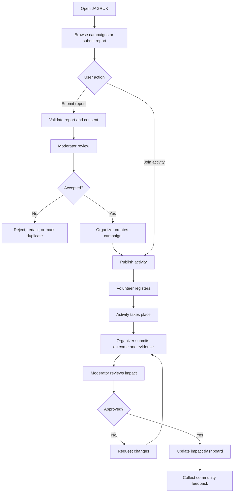

# JAGRUK — Community Awareness & Action Network
**CEP Project Requirements Document (PRD)**  
**Tagline:** Don't Just Spread Awareness. Create Action.  
**Version:** 1.0 | **Project type:** Community Engagement Project (CEP) | **Pilot context:** College + one local community

## 1. Executive Summary
JAGRUK is a community platform that turns awareness into coordinated, measurable local action. Residents can report non-emergency community issues, discover verified awareness events, volunteer for nearby activities, and track outcomes. Student groups, NGOs, and authorized community coordinators can create campaigns, organize volunteers, and publish evidence-based impact summaries.

JAGRUK is a proposed solution, not a claim that no similar product exists. Its differentiator is the CEP-focused workflow that links a reported need to a campaign, volunteer participation, evidence review, and an impact record in one place.

## 2. Problem Statement
Local awareness activities are often fragmented across posters, WhatsApp groups, campus notices, and one-time events. People may see information but lack a clear next step; organizers struggle to recruit and coordinate volunteers; and outcomes are rarely recorded consistently. This makes it difficult to know which needs remain unresolved, who is willing to help, and whether an activity made a measurable difference.

**Core problem:** There is no single, simple, locally usable workflow for the pilot community to move from identifying a problem to organizing action and documenting the result.

## 3. Proposed Solution
Build a mobile-friendly web app that supports:
1. Report a non-emergency community issue with category, description, approximate location, and optional photo.
2. Review and moderate reports to reduce spam, duplicate reports, and exposure of sensitive information.
3. Convert suitable reports into volunteer activities or awareness campaigns.
4. Let residents/students register interest and join activities.
5. Track event status, attendance, evidence, feedback, and outcome metrics.
6. Show a community impact dashboard for organizers.

**Safety boundary:** JAGRUK is not an emergency-response service. The interface should tell users to contact the relevant official emergency service for immediate danger. Reports are not guaranteed to be handled by authorities.

## 4. Goals and Success Metrics
### Goals
- Make participation easy for people who want to help locally.
- Help organizers coordinate campaigns and volunteers.
- Document outcomes instead of counting only impressions.
- Give students a practical, measurable CEP project.

### Pilot metrics (targets to validate, not guaranteed outcomes)
- 50 community members reached during the pilot.
- 20 verified sign-ups or volunteer expressions of interest.
- 3 community activities published.
- At least 2 activities completed with evidence and feedback.
- 70% of post-activity respondents report improved understanding of the selected issue.
- 80% of submitted reports reviewed by a moderator within 48 hours.

## 5. Target Users and Roles
- **Resident / Student:** browse campaigns, submit reports, register for activities, give feedback.
- **Volunteer:** join activities, check in, submit permitted evidence, receive participation badges.
- **Organizer:** create and manage campaigns, set capacity and schedule, review registrations, record outcomes.
- **Moderator / Admin:** review reports and media, merge duplicates, remove abusive content, manage users and audit actions.
- **Community partner (optional):** NGO, college club, or resident group that co-organizes an activity.

Use role-based access control. Admin privileges must not be available to ordinary users.

## 6. Core User Journeys
### Journey A — Report to action
Sign in → submit issue → moderator reviews → duplicate/valid status assigned → organizer converts it to a campaign → volunteers register → activity occurs → evidence/outcome submitted → moderator approves summary.

### Journey B — Join an activity
Browse campaigns → filter by category/date/area → open details → review accessibility and safety notes → register → receive confirmation → attend/check in → give feedback.

### Journey C — Organizer creates campaign
Organizer profile approved → create campaign → define goal, date, capacity, location, supplies, risk notes, and contact → publish → manage registrations → mark complete → submit impact report.

## 7. Five Differentiating Features
1. **Awareness-to-Action Matching:** suitable, reviewed reports can be converted into volunteer campaigns, closing the gap between information and participation.
2. **Local Need Board with Duplicate Detection:** groups similar reports and lets moderators merge duplicates; location is approximate by default.
3. **Trust & Evidence Workflow:** campaign outcomes require organizer notes and optional evidence; a moderator reviews the impact summary before it is marked verified.
4. **Impact Ledger:** tracks participation, materials collected/distributed, feedback, and before/after observations without claiming causation beyond the evidence.
5. **Low-Data, Multilingual Participation:** lightweight mobile layout, simple language, and planned English/Marathi/Hindi labels to reduce barriers to participation.
6. **Pan-India Campaign Discovery & Citizen Photo Upload Wall:** Expands participation beyond local boundaries to nationwide environmental initiatives (e.g., Assam/Darjeeling tea plantations, Munnar Western Ghats eco-camping, Nagpur afforestation). Volunteers anywhere in India can join active drives, upload geotagged action photos with stories, applaud fellow citizens, and earn verifiable Green Hero Certificates.

These features are proposed differentiators for this project. They should not be marketed as globally unique without competitor research.

## 8. MVP Scope
### In scope
- Responsive web app / PWA-style experience.
- Email/password or institution-approved sign-in.
- User profiles and roles.
- Issue submission, moderation status, and campaign listing.
- Volunteer registration and capacity limits.
- Activity status and impact report.
- Admin dashboard and basic analytics.
- Consent, privacy notice, report/block controls, and audit log.

### Out of scope for first version
- Emergency dispatch, guaranteed government escalation, payments, public live tracking of individuals, facial recognition, AI decisions on people, public display of precise home addresses, and automated claims of verified impact.
- Native Android/iOS apps; start with a responsive web app.
- Automated authority integration unless a formal partner and API access are available.

## 9. Functional Requirements
- FR-01: A user can create an account and select a role request.
- FR-02: A resident can submit a report with category, description, approximate area, and optional image.
- FR-03: The system assigns report status: `submitted`, `under_review`, `accepted`, `converted_to_campaign`, `duplicate`, `rejected`, or `resolved`.
- FR-04: Moderators can review, redact, merge, accept, or reject reports and must record a reason for rejection.
- FR-05: An approved organizer can create a campaign with goal, date/time, location area, capacity, safety notes, and category.
- FR-06: Users can register/cancel subject to capacity and deadlines.
- FR-07: Organizers can record attendance and mark campaign status.
- FR-08: Organizers can submit an impact report with metrics, notes, and optional evidence.
- FR-09: Moderators can approve, request changes, or reject an impact report.
- FR-10: Users can provide post-activity feedback.
- FR-11: Admins can view aggregated metrics and audit logs.
- FR-12: Users can report abusive content and request account deletion.
- FR-13: Pan-India Campaign Discovery, Volunteer Participation & Citizen Photo Upload Gallery. Users anywhere across India can browse campaigns filtered by state/city/category (e.g. tea plantation, afforestation, eco-camping), register with digital passes, upload action photos (via device file upload or camera with live browser preview), applaud community photos, and generate printable Green Hero certificates.

## 10. Non-Functional Requirements
- Mobile-first, accessible UI; readable typography and clear status labels.
- Typical list/detail pages should load within 3 seconds on a reasonable mobile connection in the pilot.
- Validate and sanitize all inputs; restrict file types and size; scan uploads where supported.
- Enforce authentication, authorization, rate limiting, and secure password handling through a reputable auth provider or a properly configured backend.
- Collect the minimum personal data required; never show private phone/email publicly.
- Obtain consent before publishing identifiable photos; provide an option to participate without being photographed.
- Back up data and define a retention/deletion policy.
- Keep a moderation and incident-response process.

## 11. Suggested Technology Stack
**Beginner-friendly MVP:** React + Vite (frontend), Node.js + Express (API), PostgreSQL (database), Prisma ORM, and Supabase Auth/Storage or equivalent.  
**Alternative quick prototype:** React + Vite + Supabase (Auth, Postgres, Storage, Row-Level Security).  
**Deployment:** frontend on Vercel/Netlify; API on Render/Fly.io or equivalent; database on managed PostgreSQL. Confirm current free-tier limits before choosing providers.

## 12. Database Design
Use PostgreSQL. Primary keys may be UUIDs; timestamps use UTC. Store only approximate public location; keep precise contact/location data private if genuinely required.

### `users`
- `id UUID PK`
- `full_name VARCHAR(100)`
- `email VARCHAR(255) UNIQUE`
- `password_hash` only if auth is managed in-house; otherwise omit and use provider identity
- `role ENUM(resident, volunteer, organizer, moderator, admin)`
- `preferred_language VARCHAR(10)`
- `area_label VARCHAR(120)` (not a home address)
- `is_active BOOLEAN`
- `created_at TIMESTAMP`

### `reports`
- `id UUID PK`
- `submitted_by UUID FK users.id`
- `category VARCHAR(40)`
- `title VARCHAR(140)`
- `description TEXT`
- `area_label VARCHAR(120)`
- `latitude_approx DECIMAL(9,6) NULL`
- `longitude_approx DECIMAL(9,6) NULL`
- `image_url TEXT NULL`
- `status VARCHAR(30)`
- `moderation_note TEXT NULL`
- `duplicate_of UUID FK reports.id NULL`
- `created_at TIMESTAMP`
- `updated_at TIMESTAMP`

### `campaigns`
- `id UUID PK`
- `created_by UUID FK users.id`
- `source_report_id UUID FK reports.id NULL`
- `title VARCHAR(160)`
- `description TEXT`
- `category VARCHAR(40)`
- `goal TEXT`
- `start_at TIMESTAMP`
- `end_at TIMESTAMP NULL`
- `area_label VARCHAR(120)`
- `state VARCHAR(60)` (e.g., Maharashtra, Assam, Kerala, West Bengal, Karnataka)
- `city VARCHAR(80)` (e.g., Nagpur, Jorhat, Munnar, Darjeeling, Bengaluru)
- `latitude_approx DECIMAL(9,6) NULL`
- `longitude_approx DECIMAL(9,6) NULL`
- `capacity INTEGER`
- `safety_notes TEXT`
- `status VARCHAR(30)` (draft/published/full/in_progress/completed/cancelled)
- `created_at TIMESTAMP`

### `campaign_photos`
- `id UUID PK`
- `campaign_id UUID FK campaigns.id NULL`
- `volunteer_name VARCHAR(100)`
- `state VARCHAR(60)`
- `city VARCHAR(80)`
- `category VARCHAR(40)`
- `photo_url TEXT`
- `caption TEXT`
- `metric VARCHAR(100) NULL`
- `cheers INTEGER DEFAULT 0`
- `verified BOOLEAN DEFAULT TRUE`
- `uploaded_at TIMESTAMP`

### `registrations`
- `id UUID PK`
- `campaign_id UUID FK campaigns.id`
- `user_id UUID FK users.id`
- `status VARCHAR(20)` (registered/cancelled/attended/no_show)
- `registered_at TIMESTAMP`
- UNIQUE (`campaign_id`, `user_id`)

### `impact_reports`
- `id UUID PK`
- `campaign_id UUID FK campaigns.id UNIQUE`
- `submitted_by UUID FK users.id`
- `participants_count INTEGER`
- `metric_name VARCHAR(80) NULL`
- `metric_before DECIMAL NULL`
- `metric_after DECIMAL NULL`
- `summary TEXT`
- `evidence_url TEXT NULL`
- `review_status VARCHAR(20)` (pending/approved/changes_requested/rejected)
- `reviewed_by UUID FK users.id NULL`
- `reviewed_at TIMESTAMP NULL`
- `created_at TIMESTAMP`

### `feedback`
- `id UUID PK`
- `campaign_id UUID FK campaigns.id`
- `user_id UUID FK users.id`
- `rating INTEGER` (1–5)
- `comments TEXT NULL`
- `created_at TIMESTAMP`
- UNIQUE (`campaign_id`, `user_id`)

### `audit_logs`
- `id UUID PK`
- `actor_id UUID FK users.id`
- `action VARCHAR(80)`
- `entity_type VARCHAR(40)`
- `entity_id UUID`
- `reason TEXT NULL`
- `created_at TIMESTAMP`

### Relationships
- One user can submit many reports and create many campaigns.
- A report may produce zero or one campaign; a campaign can have many registrations.
- A campaign has zero or one impact report and many feedback records.
- Moderation decisions and important status changes are written to audit logs.

## 13. Flowchart

## 14. UI / Website Concept
### Public pages
- **Home:** headline, “Report a Need” and “Find an Activity” actions, featured campaigns, impact summary.
- **Explore:** filters for category, date, and area; campaign cards with status and available spots.
- **Report a Need:** short form, photo consent, approximate location, privacy warning, non-emergency notice.
- **Campaign Details:** purpose, organizer, date, area, capacity, accessibility/safety notes, register button.
- **How It Works:** report → organize → participate → verify impact.

### Signed-in pages
- **My Activity:** registrations, saved campaigns, submitted reports, status updates.
- **Organizer Dashboard:** create campaign, attendee list, check-in, impact submission.
- **Moderator Console:** review queue, duplicates, media checks, report/block actions, audit history.
- **Impact Dashboard:** completed campaigns, volunteer hours (if collected), participants, measured outputs, feedback.

### Visual direction
Friendly, civic, trustworthy; use a clean light background, deep teal/green accents, warm highlight color, large readable cards, simple icons, accessible contrast, and mobile-first layouts. Avoid gamifying sensitive reports or turning community needs into a popularity contest.

## 15. Privacy, Safety, and Ethics
- Do not collect Aadhaar or unnecessary sensitive information.
- Never publish a user's phone number, email, or exact home location.
- Avoid collecting reports about named private individuals.
- Require consent for identifiable photos and provide photo-free participation.
- Moderate harmful content, misinformation, harassment, and duplicate reports.
- Explain that reports are community submissions, not official findings.
- Provide a clear route to official emergency services for immediate danger.
- Use transparent, evidence-based impact claims; show the source and date of metrics.
- Establish organizer safety guidance for outdoor activities, permissions, weather, first aid, and minors.

## 16. Pilot Plan (4 Weeks)
- **Week 1 — Discovery:** select one community issue, interview 10–15 residents/students, collect baseline observations, confirm partner and safety rules.
- **Week 2 — Prototype:** build clickable wireframes, test with 5 users, refine forms and campaign discovery.
- **Week 3 — MVP + Campaign:** implement core flows and run one small awareness/volunteer activity.
- **Week 4 — Evaluation:** collect feedback, compare baseline and after observations, document limitations, present verified results.

## 17. Risks and Mitigations
- **Low participation:** work with one college club/community partner and start with one focused issue.
- **False or duplicate reports:** moderation queue, duplicate linking, rate limits.
- **Safety or privacy incident:** minimal data, approximate locations, consent, moderation and removal workflow.
- **Unverified impact claims:** evidence review, clear metric definitions, no automatic “verified” status.
- **Scope creep:** ship reporting, campaign listing, registration, moderation, and impact report first.

## 18. Acceptance Criteria
The MVP is ready for pilot when:
- A user can submit a report and see its status.
- A moderator can accept/reject/merge a report with an audit trail.
- An approved organizer can publish a campaign.
- A user can register and capacity is enforced.
- An organizer can submit an impact report.
- A moderator can approve or request changes.
- Dashboard totals are calculated from stored records.
- Privacy notice, consent, report/block, and emergency disclaimer are visible.
- Core flows work on a mobile viewport and are tested with at least five users.

## 19. Demo Script (60–90 seconds)
1. Show the home page and explain the gap between awareness and action.
2. Submit a sample non-emergency report about plastic waste in a public area.
3. Switch to moderator view and accept it after review.
4. Create a clean-up awareness campaign linked to the report.
5. Register as a volunteer and show capacity/status.
6. Complete a simulated activity and submit a clearly labelled demo impact report.
7. Show the dashboard and explain that pilot results must be measured in the real community.

## 20. Limitations and Validation
JAGRUK is a proposed CEP prototype. Similar civic-reporting, volunteering, and campaign tools may already exist. Before claiming novelty, compare relevant products and interview users. Validate the need with a local survey and present only measured pilot results as outcomes.
